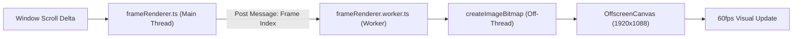

# Animation & Motion Architecture Guide — Mister Mapillai

This guide details the animation architecture, motion libraries, canvas rendering workers, and reduced-motion fallbacks implemented across the **Mister Mapillai** application.

---

## 1. Animation System Overview

The motion system is built on four distinct, decoupled layers:

1. **Scroll-Driven Frame Sequences**: Dedicated Web Worker on an `OffscreenCanvas` (`src/sections/Home/frameRenderer.ts` & `frameRenderer.worker.ts`) executing 60fps canvas drawing without blocking React.
2. **GSAP & ScrollTrigger Timelines**: Declarative section entrances, scrubbed timeline paths, and pinning (`src/animations/scroll.ts`).
3. **Continuous Compositor Animations**: Native CSS `@keyframes` animations utilizing hardware-accelerated transforms (`translate3d`, `scale`, `rotate`) for continuous orbital motion and smooth hover transitions (`src/styles/template.css`).
4. **Vector Motion Graphics (Lottie)**: Lazy-loaded SVG emblem animations for the entrance preloader (`src/components/layout/SiteLoader.tsx`).

---

## 2. Directory Structure (`src/animations/`)

```text
src/animations/
├── easings.ts            # Standardized cubic-bezier curves and glide physics
├── scroll.ts             # Safe GSAP & ScrollTrigger registration and matchMedia
└── index.ts              # Unified animation barrel export
```

---

## 3. Hero Frame Sequence System

The home hero features a high-performance scroll-driven sequence of 192 full-resolution frames (1920×1088).

### Architecture Flow:


### Key Technical Properties:
- **Off-Thread Decoding**: Frames are decoded ahead of time with `createImageBitmap` inside the worker at 1:1 screen resolution.
- **Memory Window Budget**: 14 frames ahead and 3 frames behind are kept decoded in memory; older frames are explicitly freed via `ImageBitmap.close()`.
- **Coarse-to-Fine Loading**: Frame 1 (poster) is fetched with `fetchpriority="high"`, followed by frames around current scroll position, then every 32nd frame, until all 192 frames are cached.
- **Zero Layout Shift**: The canvas uses `contain` scaling (`frameScale` utility), ensuring full subject visibility across all aspect ratios.

---

## 4. GSAP & ScrollTrigger Patterns

### Safe Context Initialization
Always wrap ScrollTrigger animations in `createSafeMotionContext` or `gsap.matchMedia()`:

```typescript
import { useEffect, useRef } from 'react';
import { gsap, ScrollTrigger, createSafeMotionContext } from '../../animations';

export function MySection() {
  const containerRef = useRef<HTMLDivElement>(null);

  useEffect(() => {
    return createSafeMotionContext((ctx) => {
      gsap.from('.mm-reveal-card', {
        y: 40,
        opacity: 0,
        duration: 0.8,
        stagger: 0.15,
        ease: 'power2.out',
        scrollTrigger: {
          trigger: containerRef.current,
          start: 'top 80%',
          once: true,
        },
      });
    });
  }, []);

  return <div ref={containerRef}>...</div>;
}
```

### Gold Line & Timeline Fill
Vertical and horizontal progress lines use GSAP scrubbed `scaleY` / `scaleX` transforms:
```typescript
gsap.fromTo(line, { scaleY: 0 }, {
  scaleY: 1,
  ease: 'none',
  scrollTrigger: {
    trigger: root,
    start: 'top 75%',
    end: 'bottom 70%',
    scrub: 0.4,
  },
});
```

---

## 5. 3D Collection Carousel Motion

The **Signature Looks** carousel in `src/sections/Collections/CollectionCarousel.tsx` uses custom 3D perspective geometry:
- Displays exactly 3 cards simultaneously: Left (angled inward), Center (forward, elevated), Right (angled inward).
- Transforms are applied via GPU matrix translates and individual `rotateY` transforms:
  - Center: `transform: translate3d(0, 0, 0) scale(1) rotateY(0deg)`
  - Left: `transform: translate3d(-340px, 0, -180px) scale(0.82) rotateY(26deg)`
  - Right: `transform: translate3d(340px, 0, -180px) scale(0.82) rotateY(-26deg)`
- Rotates smoothly through all 13 collection items without layout thrashing.

---

## 6. Styling Orbit Rotation

The **Orbit Accessories** showcase in `src/sections/Collections/StylingOrbit.tsx` uses synchronized counter-rotations on the compositor:
- The outer ring rotates clockwise: `animation: mm-orbit-spin 54s linear infinite`.
- Each accessory chip counter-rotates counter-clockwise: `animation: mm-orbit-counter 54s linear infinite`.
- Result: Accessory chips orbit smoothly in a circle while their icons, images, and labels remain upright.
- Pauses smoothly on hover or focus: `animation-play-state: paused`.

---

## 7. Reduced Motion Guidelines

The application strictly honors `prefers-reduced-motion: reduce`:
1. **Hero Sequence**: Disabled; pins are released, no sequence is downloaded, and the static high-res poster (`frame_0001.webp`) is rendered.
2. **GSAP**: `createSafeMotionContext` automatically skips ScrollTrigger executions.
3. **CSS**: In `src/styles/accessibility.css` and `src/styles/template.css`, animations and transitions are set to `none`, and transform states immediately snap to their final visible resting coordinates.
